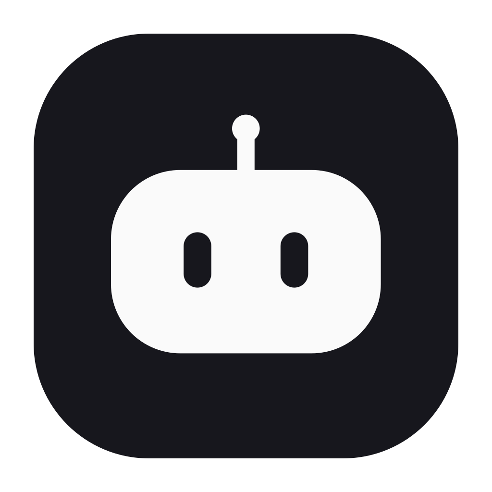

# Agenteeq

**Všichni AI agenti na jednom místě, v reálném čase.** Agenteeq vidí, co právě dělá Claude Code, Codex, Cursor, Copilot i webové chaty (ChatGPT, Claude.ai, Gemini, Microsoft Copilot, Perplexity, Grok, Qwen). Ukáže živý přepis a průběh úlohy. Upozorní, když agent potřebuje tvé rozhodnutí, narazí na limit nebo když útrata přeroste rozpočet.

> **0.46.65** — Preview kandidát: pestřejší flákání robotů (část čekajících je v klidu, osm různých zábav) a přesouvání karet v detailu stejně plynulé jako na Přehledu.
>
> **0.46.64** — veřejné Preview: ikona Chrome rozšíření ukazuje tečkou stav agentů (potřebuje tě, selhalo, limit, pracuje; šedá = nezjištěno), popisek ikony říká stav větou.
>
> **0.46.63** — veřejné Preview: roboti v dílně (pracující robot je zády u stolku s kladivem nebo pilkou, obrobek roste se skutečnou délkou úkolu), otočka jako zaoblené těleso, flákání čekajících, volání anténou, nové nohy a filtry Agentů bez vodorovného posouvání. Obsahuje i nezveřejněnou 0.46.62.
>
> **0.46.62** — nezveřejněný kandidát, je součástí 0.46.63: Agenteeq načítá i cloudové úlohy nativní aplikace Codex, které nemají místní přepis. Nedostupný zdroj ukáže jako chybu. Veřejné Preview 0.46.61 vzniklo bez této opravy. Po ověření nového kandidáta bude náprava ve verzi 0.46.62.
>
> **0.46.60** — [veřejné Preview](https://github.com/martin-pok/agentree/releases/tag/v0.46.60) zveřejněné 23. 10. 2026 z přesného commitu `90229c0` po 8/8 CI a auditu všech osmi příloh. Přináší opravu jazyka při aktualizaci, skutečné názvy a místní přepisy webových konverzací. Na Macu vlastníka běží 0.46.60 a zachovalo se uložené nastavení, projekty, upozornění i párování. Fyzické UAT Windows, aktualizace rozšíření v Chromu a celé ověření nových funkcí zůstávají otevřené. [v0.46.58](https://github.com/martin-pok/agentree/releases/tag/v0.46.58) je nadále Stable Latest.
>
> **Starší záznamy níže popisují stav v době příslušného vydání, nikoli aktuální release.**
>
> **0.46.14** — **historický neměnný kandidát s tagem na `43fbc39`; release build běží.** Slučuje opravu zaseknutých aktualizací Macu a bezpečného ukončení ([#262](https://github.com/martin-pok/agentree/pull/262)), editor vzhledu na detailu agenta ([#261](https://github.com/martin-pok/agentree/pull/261)) a minimalistickou ruční obnovu ([#260](https://github.com/martin-pok/agentree/pull/260)). Nativní QA aktualizací na macOS runneru u #262 prošlo **17/17** včetně zaseknuté služby; **instalace na uživatelově Macu zatím není ověřená**. Teprve přesné zelené CI na finálním `main`, neměnný tag, Draft s nezávislým SHA-256 auditem a reálný Mac UAT umožní označit vydání za připravené k publikaci. Starší 0.46.13 je soukromý Draft a veřejné Preview je stále 0.46.12.
>
> **0.46.13** — **již sestavený neveřejný Draft, nezveřejněný.** Po zeleném 8/8 CI vznikl neměnný tag `v0.46.13` a soukromý Draft s 8 přílohami, které nezávislý audit stáhl a ověřil proti SHA-256. Obsah: bezpečné zotavení po chybě aktualizace na Macu ([#254](https://github.com/martin-pok/agentree/pull/254)), potvrzený Codex limit viditelný jako problém ([#258](https://github.com/martin-pok/agentree/pull/258)), notifikace a odhlášení ([#256](https://github.com/martin-pok/agentree/pull/256)), přehlednější editor projektu a Dovednosti ([#259](https://github.com/martin-pok/agentree/pull/259)), plus plynulejší Agenti se stovkou konverzací a opravy textů. Zveřejnění jako Preview až po vyzkoušení na Macu a výslovném schválení vlastníka; do té doby je veřejné Preview `v0.46.12` a Stable Latest `v0.46.0`.
>
> **Předchozí: 0.46.12** — **zveřejněné Preview** ([v0.46.12](https://github.com/martin-pok/agentree/releases/tag/v0.46.12), 14. 10. 2026 06:45 UTC). Tag `v0.46.12` na `0e7faeefae05ddc59347e17b0891b4c830643507` prošel 8/8 CI na `main`; [sestavení](https://github.com/martin-pok/agentree/actions/runs/38522725182) založilo Draft s 8 přílohami, nezávislý audit i [zveřejnění](https://github.com/martin-pok/agentree/actions/runs/38524076913) znovu stáhly a ověřily všech 8 příloh proti SHA-256. Zveřejněno na výslovný pokyn vlastníka **bez dokončeného fyzického UAT** (Mac, Chrome, Windows, Google přihlášení, Gatekeeper) – to zůstává otevřené v [#208](https://github.com/martin-pok/agentree/issues/208). Stable Latest zůstává `v0.46.0`; Chrome Web Store se aktualizuje samostatně.
>
> **Historický zablokovaný kandidát:** **0.46.11** — neveřejný Draft, nyní zablokovaný pro publikaci. Tag na `1e72a0057637ad249e70388444346a80526e7083` prošel [8/8 CI](https://github.com/martin-pok/agentree/actions/runs/38430918556); Draft ID `411899483` má osm příloh ověřených 8/8 proti GitHub SHA-256 a 7/7 proti manifestu. Po výslovném souhlasu byla skutečná aplikace z DMG nainstalována na Apple Silicon Mac, spustila se i po restartu a zachovala viditelný účet, upozornění a projekty. `spctl` však ad-hoc balík odmítl a fyzická kontrola našla v PWA/Apple PNG starší hlavu s fialovou anténou. [Oprava #231](https://github.com/martin-pok/agentree/pull/231) nemění neměnné binárky 0.46.11; tento Draft nezveřejňovat. Google OAuth, Chrome/Windows a celé UAT zůstávají otevřené. Před `v0.46.12` bylo veřejné Preview [v0.46.6](https://github.com/martin-pok/agentree/releases/tag/v0.46.6); Stable Latest zůstává `v0.46.0`.
>
> **Historie nevydaných buildů:** Drafty 0.46.7–0.46.11 jsou neměnné a nejsou veřejnou aktualizací. Nový distribuční kandidát vyžaduje opravené binárky, přesné zelené CI, audit příloh a živé UAT; samotný commit ani Draft dostupnost nedokazuje. [Roadmapa](docs/ROADMAP.md) · [Kontrola vydání](docs/RELEASE-READINESS.md) · [Brand/UAT #213](https://github.com/martin-pok/agentree/issues/213).
>
> **Desktop:** aplikace pro macOS (Apple Silicon). Swift/AppKit + WebKit, přibalený Node, lokální fonty, průvodce, vlastní nabídky a řízený životní cyklus serveru. Build je zatím podepsaný ad-hoc (bez Developer ID a notarizace), proto ho macOS napoprvé zablokuje a jednou ho povolíš v Nastavení systému. Stav konektorů popisuje [docs/CONNECTORS.md](docs/CONNECTORS.md).

## Instalace

**[Stáhnout pro Mac (DMG)](https://github.com/martin-pok/agentree/releases/latest/download/Agenteeq-macOS-arm64.dmg)** · **[Stáhnout pro Windows (beta)](https://github.com/martin-pok/agentree/releases/latest)** · [postup na webu](https://agentree-fawn.vercel.app/instalace)

Mac (Apple Silicon, M1 a novější, macOS 14+; Mac s procesorem Intel nepodporujeme), bez Terminálu:

1. Stáhni a otevři obraz disku DMG.
2. V okně instalátoru přetáhni Agenteeq do složky Aplikace.
3. Otevři Agenteeq. macOS ohlásí, že aplikaci nemůže ověřit – dialog zavři.
4. Nastavení systému → Soukromí a zabezpečení → v části Zabezpečení klikni na **Přesto otevřít** a potvrď heslem. Příště se Agenteeq otevře dvojklikem.

Windows 10 a 11 jsou beta: balíček se sestavuje s každým vydáním (na stránce vydání soubor `Agenteeq-<verze>-Windows-x64.zip`), ale na skutečném počítači ho zatím nikdo nevyzkoušel – viz [docs/WINDOWS.md](docs/WINDOWS.md).

Pro pokročilé: instalace jedním příkazem v Terminálu (stáhne poslední vydání, ověří otisk SHA-256 z GitHubu a nainstaluje bez kroku v Nastavení): `curl -fsSL https://agentree-fawn.vercel.app/install.sh | bash`. Sestavení ze zdrojů: `npm run build:mac` a `npm run build:dmg` (macOS 14+, Xcode tools). Podrobnosti: [Instalace](docs/INSTALL.md).

## Rychlý start ze zdrojů

Potřebuješ macOS a Node.js 22.13 nebo novější. Žádné závislosti, žádný build.

```bash
cd ~/agenteeq
npm start
```

Otevři odkaz `Přehled: http://127.0.0.1:4620/?k=…`, který se vypíše do Terminálu (nebo spusť `npm start -- --open`); adresa bez klíče přehled neukáže. Průvodce v Přehledu tě provede napojením (hooky Claude Code, rozšíření pro Chrome, první projekt, první spuštění agenta). Automatické spouštění po přihlášení zapneš v **Nastavení → Spouštění a data**.

Instalace pro zákazníka nebo kolegu: `npm run pack` a návod [docs/INSTALL.md](docs/INSTALL.md). Licence a prodej: [docs/LICENSING.md](docs/LICENSING.md).

Vzdálené relace Claude Code z Claude Desktopu se načítají automaticky z místní cache. Tento zdroj je Beta: dostupný přepis a tokeny mohou být neúplné; poslední hlášený stav není zárukou aktuálního stavu v cloudu.

## Co umí

| Oblast | Funkce |
|---|---|
| Přehled | **Spustit agenta** (Claude Code, Codex, Gemini/Qwen CLI, webové AI, lokální Ollama) s projektem, složkou a briefem; kolik agentů pracuje, kdo čeká na tebe, časová osa „Dnešní směna“, spotřeba tokenů, limity předplatných, útrata měsíce |
| Agenti | Seznam všech sessions (30 dní) s filtry podle stavu, zdroje, poskytovatele a projektu, hromadné zařazení do projektu, přetažení na projekt |
| Projekty | Konverzace ze všech služeb podle klientů a zakázek: automaticky podle složky i ručně, stav a tokeny projektu, brief, archiv, export do CSV |
| Detail agenta | Živý přepis (zprávy, nástroje, výstupy), běžící čas tahu a počet kroků, složení tokenů; **otevření přímo v aplikaci** (vlákno Codexu, Claude, Cursor, VS Code, web) nebo **pokračování v Terminálu** |
| Statistiky | Tokeny podle poskytovatele, heatmapa aktivity, podíl aplikací, projekty, modely, limity a kredity |
| Útrata | Automatické náklady z připojených Admin API, zjištěné plány Claude Code a Codexu bez odhadovaných cen, rozpočty, historie kreditů a export starších ručních záznamů |
| Upozornění | Rozhodnutí, limity, rozpočty, dokončené dlouhé úlohy. Nativní notifikace macOS, notifikace prohlížeče, přehled v aplikaci. Noční ticho s jedním souhrnem na konci (jen za to, co pořád platí) a souhrn místo série, když jich přijde víc než tři za minutu |
| Dovednosti | Místní soubory `SKILL.md` ze sdílené složky `~/.agents/skills`, Claude, jeho pluginů a Codexu; hledání a filtrování podle zdroje a původu |

## Vývoj

```bash
npm run audit:data  # porovná, co aplikace ukazuje, se surovými zdroji na tomto Macu
npm test          # 1397 testů: parsery, stav, upozornění, rozpočty, hooky, projekty, spouštění, licence, dovednosti, vlastní agenti, kredity, HTTP API, realtime stream, Tailscale, web, rozšíření, vydání a DMG
npm run check     # syntaktická kontrola všech JS souborů
npm run smoke     # zabalí balíček, nainstaluje ho do dočasné složky a ověří, že běží
npm run dev       # server s automatickým restartem při změně src/

npm run build:extension   # balíček rozšíření pro Chrome
npm run build:site        # web: landing page + rozhraní aplikace na /app
npm run release:mac       # celé vydání pro macOS (viz docs/LICENSING.md)
```

## Web

`site/` je veřejná landing page, `public/` je rozhraní aplikace. `npm run build:site` z obou složí
`dist/web`: stránka v kořeni, rozhraní na `/app`. Hosting (`vercel.json`) si build spustí sám.
Produkt na stránce ukazují výřezy skutečného rozhraní se smyšlenými daty (`site/detail/`, `docs/SHOWCASE.md`).

Než začneš měnit kód (člověk i AI agent), přečti **[AGENTS.md](AGENTS.md)**.

## Dokumentace

| Dokument | Obsah |
|---|---|
| [AGENTS.md](AGENTS.md) | Pravidla a postupy pro agentický vývoj, definice hotového, mapa repozitáře |
| [docs/PRODUCT-AND-ARCHITECTURE.md](docs/PRODUCT-AND-ARCHITECTURE.md) | Produktový kompas, UX/UI standard, vzhledové režimy, hranice konektorů, architektura a releasová brána |
| [docs/ARCHITECTURE.md](docs/ARCHITECTURE.md) | Jak data tečou od zdroje do dashboardu, stavový model, výkon, odolnost |
| [docs/CONNECTORS.md](docs/CONNECTORS.md) | Podpora jednotlivých služeb: co jde, co nejde a proč, stav ověření |
| [docs/DATA-CONTRACT.md](docs/DATA-CONTRACT.md) | REST API, SSE události a datové typy |
| [docs/SECURITY.md](docs/SECURITY.md) | Model hrozeb, soukromí, práce s klíči a konfigurací uživatele |
| [docs/TESTING.md](docs/TESTING.md) | Automatické testy, ruční QA checklist, protokol ověření verze |
| [docs/INSTALL.md](docs/INSTALL.md) | Instalace a napojení pro zákazníky |
| [docs/LICENSING.md](docs/LICENSING.md) | Vydávání licencí, placené funkce, distribuce (pro vydavatele) |
| [docs/PRODUCT.md](docs/PRODUCT.md) | Vize, zákazník, hodnota, hypotézy monetizace (neověřené) |
| [docs/BRAND.md](docs/BRAND.md) | Jméno produktu: kde všude žije, co stojí přejmenování a jak ho udělat bez ztráty dat |
| [docs/legal/README.md](docs/legal/README.md) | **Pracovní, neúčinné právní návrhy k revizi**: CZ/EN Terms, GDPR audit, ochrana značky, IP evidence, bezplatné audity a předkomerční checklist |
| [docs/REMOTE.md](docs/REMOTE.md) | Přístup z telefonu mimo domácí síť: napojení na Tailscale, veřejné tunely, hranice |
| [docs/ROADMAP.md](docs/ROADMAP.md) | Cesta z lokální bety k SaaS, s akceptačními kritérii |
| [CHANGELOG.md](CHANGELOG.md) | Historie verzí |
